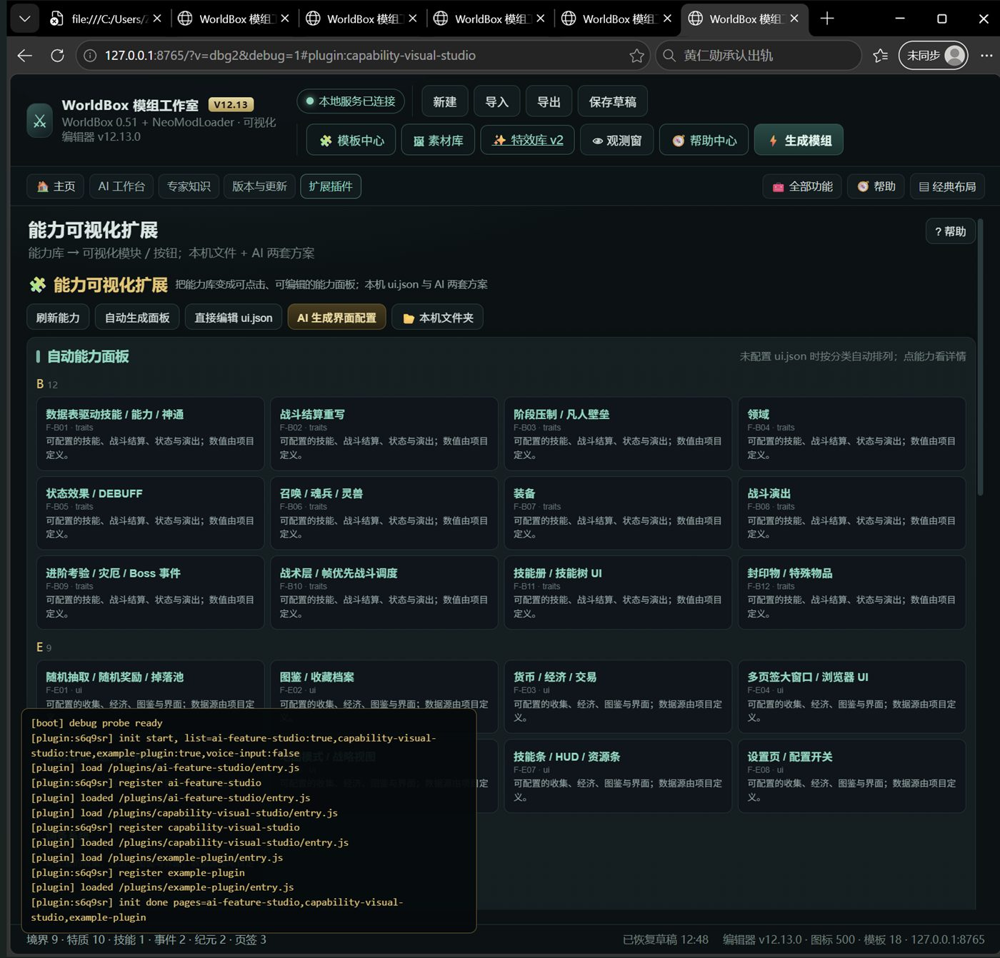
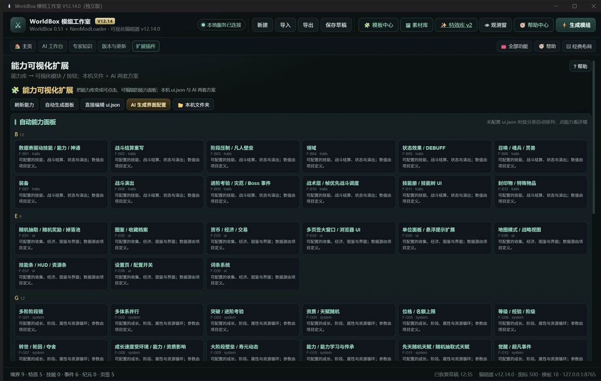
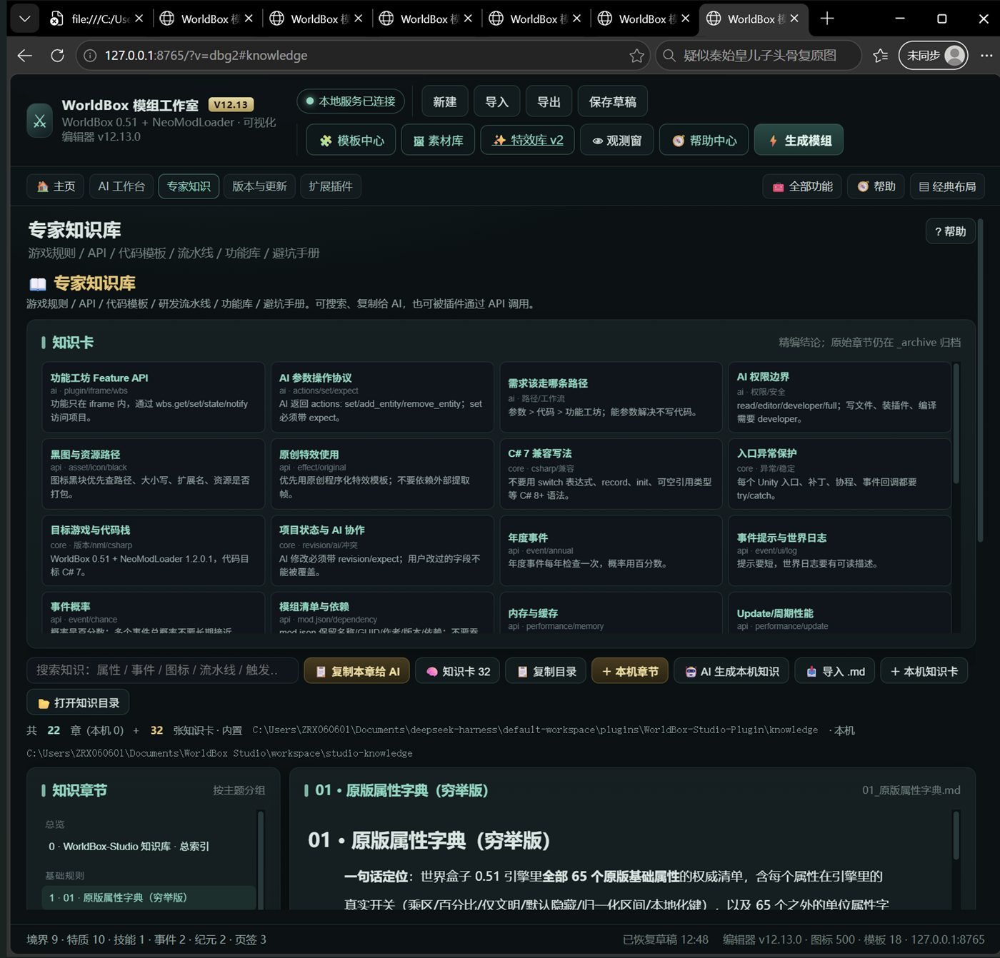
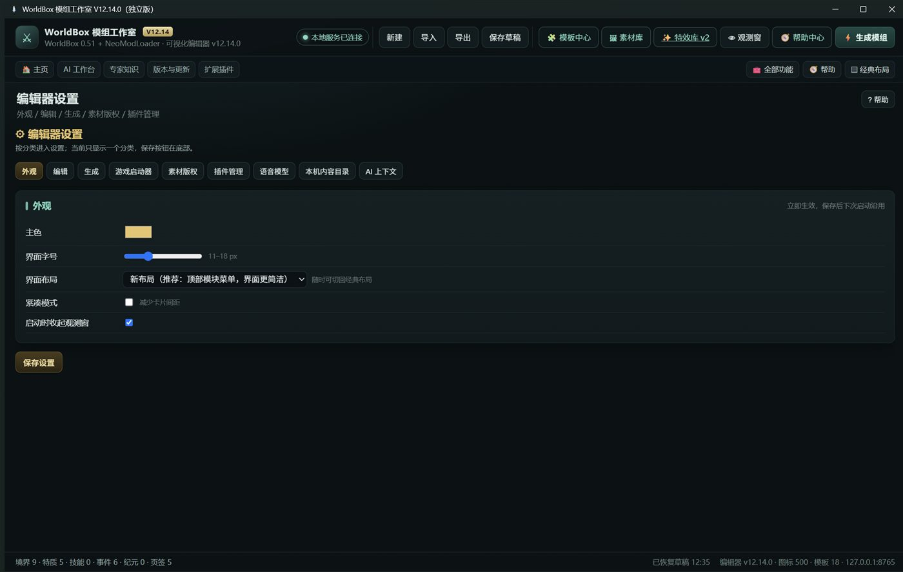

# WorldBox Studio

WorldBox 0.51 + NeoModLoader 的可视化模组编辑器，Windows x64 独立版。

当前版本：**V12.14.1**

## 下载

[⬇ 下载 WorldBox Studio V12.14.1 Windows x64](https://github.com/6678945/WorldBox-Studio/releases/download/v12.14.1/WorldBoxStudio-V12.14.1-Windows-x64.zip)

- 压缩包约 206 MB；解压后约 482 MB
- 解压整个文件夹，双击 `WorldBoxStudio.exe`，无需安装
- SHA256：`93E9E58F7E723F79FA82C506B404800F259337351B30BFE4F404530F538A52D6`

## 主要能力

- 可视化编辑体系 / 境界 / 等级展示方案
- 特质、技能、事件、纪元、触发器、UI 排版
- 生成 C# 模组 → 编译 → 打包 → 纯净测试
- AI 工作台：参数修改、代码创作、编译修复、深度创作
- 专家知识库 + 知识卡，本机知识动态增删
- 第三方插件：权限分级、沙盒、静态扫描、黑名单、免责声明、紧急下架
- 能力可视化扩展：能力库 → 可视化能力面板
- 语音输入：本机 SenseVoice 或用户自接 OpenAI 兼容语音接口

## 本机内容

安装包只带内置内容；新增内容只在本机 workspace：

    studio-knowledge     本机知识章节 + cards/
    plugins              本机插件
    studio-assets        本机素材
    studio-effects       本机特效
    studio-library       本机功能库/模板补充
    studio-capabilities  本机能力卡 + ui.json

这些内容不上传、不随安装包分发。

## 文档

- [使用说明](使用说明.md)
- [全面审查 V12.14.1](全面审查_V12.14.1.md)
- [版权审查报告](版权审查报告_V12.14.1.md)
- [LICENSE](LICENSE)
- [THIRD_PARTY_NOTICES](THIRD_PARTY_NOTICES.md)

## 截图

## 注意

- 编辑器只读游戏与 NML 文件；部署模组前需要确认。
- 编译通过不等于游戏内玩法验收，发布模组前建议做纯净测试。
- 本仓库只发布编辑器产品包；源码/插件开发目录不在本仓库。